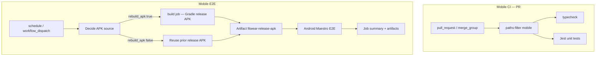

# Mobile E2E and CI/CD

How the Fitwear mobile app is tested in GitHub Actions: unit checks on pull requests, optional manual native builds, and Android Maestro end-to-end runs against a release APK and the production API.

---

## Workflow overview

| Workflow | File | Triggers | Purpose |
| --- | --- | --- | --- |
| **Mobile CI** | `.github/workflows/mobile-ci.yml` | `pull_request` → `main`, merge group, `workflow_dispatch` | Typecheck + Jest when `apps/mobile/**` (or root lockfile) changes |
| **Mobile Build** | `.github/workflows/mobile-build.yml` | `workflow_dispatch` | Optional debug APK (Windows) and/or iOS Simulator build (macOS) |
| **Mobile E2E** | `.github/workflows/mobile-e2e.yml` | Cron + `workflow_dispatch` | Release APK + Android emulator + Maestro flows |

Mobile CI does **not** run Maestro. E2E is nightly and manual only.



---

## Mobile CI (unit layer)

- **Runner:** `ubuntu-latest`, 15-minute timeout.
- **Path filter:** `apps/mobile/**`, `package.json`, `bun.lock`, workflow file.
- **Steps:** `bun install --frozen-lockfile` → `bun run --cwd apps/mobile typecheck` → `bun run --cwd apps/mobile test` (Jest, `--runInBand`).
- **Concurrency:** `${{ workflow }}-${{ ref }}`, cancel in progress.
- **Skipped PRs:** If only non-mobile paths change, a skip notice is printed and jobs are skipped.

---

## Mobile Build (optional artifacts)

Manual dispatch only. Inputs: `build_android`, `build_ios` (at least one required).

- **Android:** `windows-latest`, Expo prebuild, Gradle `assembleDebug`, artifact `fitwear-android-debug-apk`.
- **iOS:** `macos-latest`, `pod install`, `xcodebuild` for Simulator, artifact `fitwear-ios-simulator-app`.

Not used by the E2E pipeline (E2E builds or reuses a **release** APK on Linux).

---

## Mobile E2E — triggers and concurrency

**Triggers**

- **Schedule:** `0 1 * * *` in timezone `Asia/Ho_Chi_Minh` (always builds a fresh APK).
- **Manual:** `workflow_dispatch` inputs:
  - `include_tags` — comma-separated Maestro tags (OR). Empty = all top-level flows under `apps/mobile/tests/e2e/`.
  - `force_rebuild` — build a new release APK even when only flows/docs/tests changed.

**Concurrency:** Group `mobile-e2e-dedicated-account`, `cancel-in-progress: false` so only one E2E run uses the dedicated account at a time.

**Permissions:** `contents: read`, `actions: write` (needed to download `fitwear-release-apk` from prior successful runs).

---

## Job 1: Decide APK source (`prepare`)

1. **Checkout** — only when `github.event_name != 'schedule'` *(see [Known limitations](#known-limitations))*.
2. **paths-filter** (non-schedule, `force_rebuild` false): diff vs `main` for app sources — `apps/mobile/**` excluding `apps/mobile/tests/**` and `apps/mobile/README.md`, plus `package.json` and `bun.lock`.
3. **Plan APK build** — `bun .github/scripts/e2e-apk-plan.ts` → output `rebuild_apk`.

### APK plan logic (`e2e-apk-plan.ts`)

| Condition | `rebuild_apk` |
| --- | --- |
| `schedule` event | `true` |
| `force_rebuild` input | `true` |
| `filter.rebuild_apk` on `main` branch | `true` |
| App sources unchanged since last successful **`build`** job on branch (then `main`) | `false` |
| No prior successful build to reuse | `true` |

Long-lived feature branches use git diff from the **last successful build SHA** on that branch (or `main`), not only paths-filter vs `main`, so flow-only changes can skip Gradle.

---

## Job 2a: `build` (when `rebuild_apk == true`)

- Expo prebuild Android with `EXPO_PUBLIC_API_URL=https://fitwear.tm-project.id.vn/`.
- Gradle `assembleRelease` for `x86_64` (`-PreactNativeArchitectures=x86_64`), minify off, Sentry auto-upload disabled.
- Upload artifact **`fitwear-release-apk`** (`app-release.apk`).

## Job 2b: `fetch-apk` (when `rebuild_apk != true`)

1. Download `fitwear-release-apk` from the last **successful** `mobile-e2e.yml` run on the **current branch**.
2. On failure, fall back to last successful run on **`main`**.
3. Re-upload as `fitwear-release-apk` for this workflow run.

---

## Job 3: Android Maestro E2E (`e2e`)

Runs if `prepare` succeeded and `build` or `fetch-apk` succeeded/skipped as expected.

### Bootstrap

- Run unit tests for CI helper scripts: `generate-maestro-summary`, `cleanup-maestro-account`, `e2e-apk-plan`, `record-maestro-exit`.
- Download release APK into `apps/mobile/android/app/build/outputs/apk/release/`.
- Enable **KVM** on the runner (`/dev/kvm`); Maestro step uses hardware acceleration (`-accel on`).

### Emulator and Maestro

- **Image:** API 34, AOSP (`target: default`), `x86_64`, **Pixel 6** profile, 4 GB RAM.
- **Maestro:** CLI **2.12.0** via official installer.
- **Action:** `reactivecircus/android-emulator-runner@v2`.

**Emulator script (high level)**

1. `adb install -r` release APK.
2. `maestro test` on `apps/mobile/tests/e2e` with JUnit output under `maestro-artifacts/`.
3. Env: `MAESTRO_TEST_EMAIL`, `MAESTRO_TEST_PASSWORD`, optional `MAESTRO_INCLUDE_TAGS`.
4. Write Maestro exit code to `maestro-artifacts/maestro-exit-code.txt`.
5. On test failure the script still exits **0** from the emulator action so later steps can upload artifacts; the real exit code is recovered in a separate step.
6. Device cleanup: force-stop app, `pm clear`, disable airplane mode.

### Dedicated E2E account (D1 cleanup)

Before Maestro:

- **`cleanup-maestro-account.ts snapshot`** — records session and meal IDs for `MAESTRO_TEST_EMAIL` via Cloudflare D1 API (DB id from `apps/backend/wrangler.json`). State file: `RUNNER_TEMP`, not uploaded.

After Maestro (`always()`, if snapshot succeeded):

- **`cleanup-maestro-account.ts cleanup`** — deletes only sessions/meals **created after** the snapshot; account and baseline data remain.

Requires secrets: `MAESTRO_TEST_EMAIL`, `CLOUDFLARE_API_TOKEN`, `CLOUDFLARE_ACCOUNT_ID`.

### Reporting and failure semantics

| Step | Role |
| --- | --- |
| **Record Maestro exit code** | `record-maestro-exit.ts` reads `maestro-exit-code.txt` → `steps.maestro.outputs.exit_code` and `MAESTRO_EXIT_CODE` |
| **Upload recordings / artifacts** | MP4s and full `maestro-artifacts/` (attempt-suffixed names) |
| **Generate Maestro E2E summary** | Parses JUnit → GitHub **job summary** (flow table, failure details, recording links) |
| **Fail job when Maestro reported test failures** | `exit` with recorded code if non-zero |

Summary generator always exits 0 so reporting does not mask a failed test step.

---

## Maestro flows (repository)

| Flow | Path | Tags |
| --- | --- | --- |
| Error messages & validation | `apps/mobile/tests/e2e/error-messages.yaml` | `e2e`, `errors` |
| Fitness / auth journey | `apps/mobile/tests/e2e/fitness.yaml` | `e2e`, `fitness` |

**App id:** `com.fitwear.mobile`.

CI discovers **top-level** `.yaml`/`.yml` files in `tests/e2e/`. Put shared subflows in subdirectories so they are not run as separate top-level journeys.

**Conventions (from README):**

- Password fields: test IDs `login-password`, `sign-up-password`.
- Sign-up footer scroll: start swipe from submit button (date fields can steal center swipes).
- Optional `startRecording` per flow; artifacts land under `maestro-artifacts/`.

---

## Local E2E

From `apps/mobile` (requires local Maestro + device/emulator + credentials):

```bash
bun run test:e2e              # all top-level flows
bun run test:e2e:errors       # error-messages.yaml only
```

Pass credentials the same way CI does:

```bash
maestro test -e MAESTRO_TEST_EMAIL=... -e MAESTRO_TEST_PASSWORD=... tests/e2e
maestro test --include-tags fitness tests/e2e
```

Release APK for parity with CI: build with `EXPO_PUBLIC_API_URL` pointing at the same API host, install on an x86_64 emulator or device.

---

## GitHub secrets

| Secret | Used for |
| --- | --- |
| `MAESTRO_TEST_EMAIL` | Login/sign-up flows; D1 snapshot/cleanup identity |
| `MAESTRO_TEST_PASSWORD` | Maestro `-e` injection |
| `CLOUDFLARE_API_TOKEN` | D1 HTTP API (cleanup) |
| `CLOUDFLARE_ACCOUNT_ID` | D1 HTTP API (cleanup) |
| `GITHUB_TOKEN` | Default; artifact download across runs (`actions: write`) |

---

## Helper scripts (`.github/scripts/`)

| Script | Purpose |
| --- | --- |
| `e2e-apk-plan.ts` | Decide `rebuild_apk`; gh + git integration |
| `record-maestro-exit.ts` | Bridge emulator runner → workflow outputs |
| `generate-maestro-summary.ts` | JUnit → step summary markdown |
| `cleanup-maestro-account.ts` | `snapshot` / `cleanup` for D1 hygiene |

Each has a matching `*.test.ts` run in the E2E job before emulator work.

---

## Manual dispatch examples

```bash
# All flows, reuse APK when plan allows
gh workflow run mobile-e2e.yml

# Subset by tag
gh workflow run mobile-e2e.yml -f include_tags=fitness,errors

# Force fresh Gradle build
gh workflow run mobile-e2e.yml -f force_rebuild=true
```

---

## Artifacts

| Name | Contents |
| --- | --- |
| `fitwear-release-apk` | `app-release.apk` (build or reused) |
| `maestro-e2e-artifacts-<attempt>` | JUnit, logs, screenshots, exit code file |
| `fitwear-e2e-recording-<attempt>` | Flow MP4s when recorded |

Job summary links to artifact URLs when upload steps succeed.

---

## Relationship to PR checks

```
PR → Mobile CI (typecheck + Jest)     [fast, path-filtered]
Nightly / manual → Mobile E2E        [release APK + Maestro + D1 cleanup]
```

Merge gates depend on repository branch protection; E2E is not wired into `pull_request` in `mobile-e2e.yml` today.

---

## Known limitations

1. **Scheduled runs and checkout** — In `mobile-e2e.yml`, the `prepare` job skips checkout when `github.event_name == 'schedule'`, but **Plan APK build** always runs `bun .github/scripts/e2e-apk-plan.ts`, which expects a git checkout for non-schedule reuse logic and may need the repo on disk for scheduled runs too. If nightly `prepare` fails, remove or narrow the checkout `if` so scheduled runs checkout like dispatch.

2. **Single dedicated account** — Concurrency group serializes runs; parallel dispatches queue.

3. **Server-side data** — Cleanup covers sessions/meals created during a run; new flows that create other D1 entities need scoped cleanup before CI enablement.

4. **Architecture** — CI release APK is built for **x86_64** to match the Linux emulator; physical ARM devices are not the CI target.

---

## Related documentation

- Operational detail and UX notes for flows: `apps/mobile/README.md` (E2E section).
- Backend D1 binding: `apps/backend/wrangler.json` (`DB`).

*Generated from repository state; workflow source of truth: `.github/workflows/mobile-e2e.yml`.*
