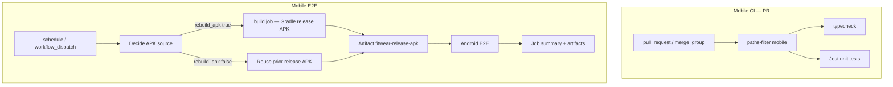

# Mobile E2E and CI/CD

How the Fitwear mobile app is tested in GitHub Actions: unit checks on pull requests, optional manual native builds, and Android end-to-end runs (e2e + @e2e-dev/mobile) against a release APK and the production API.

---

## Workflow overview

| Workflow         | File                                 | Triggers                                                  | Purpose                                                           |
| ---------------- | ------------------------------------ | --------------------------------------------------------- | ----------------------------------------------------------------- |
| **Mobile CI**    | `.github/workflows/mobile-ci.yml`    | `pull_request` → `main`, merge group, `workflow_dispatch` | Typecheck + Jest when `apps/mobile/**` (or root lockfile) changes |
| **Mobile Build** | `.github/workflows/mobile-build.yml` | `workflow_dispatch`                                       | Debug APK (Android) and iOS Simulator build, via matrix           |
| **Mobile E2E**   | `.github/workflows/mobile-e2e.yml`   | Cron + `workflow_dispatch`                                | Release APK + Android emulator + e2e tests                    |

Mobile CI does **not** run the E2E tests. E2E is nightly and manual only.



---

## Mobile CI (unit layer)

- **Runner:** `ubuntu-latest`, 15-minute timeout.
- **Path filter:** `apps/mobile/**`, `package.json`, `bun.lock`, workflow file.
- **Steps:** `bun install --frozen-lockfile` → `bun run --cwd apps/mobile typecheck` → `bun run --cwd apps/mobile test` (Jest, `--runInBand`).
- **Concurrency:** `${{ workflow }}-${{ ref }}`, cancel in progress.
- **Skipped PRs:** If only non-mobile paths change, a skip notice is printed and jobs are skipped.

---

## Mobile Build (optional artifacts)

Manual dispatch only. One matrix job builds every platform in parallel.

- **Android:** `windows-latest`, Expo prebuild, Gradle `assembleDebug`, artifact `fitwear-android-debug-apk`.
- **iOS:** `macos-latest`, `pod install`, `xcodebuild` for Simulator, artifact `fitwear-ios-simulator-app`.

Not used by the E2E pipeline (E2E builds or reuses a **release** APK on Linux).

---

## Mobile E2E — triggers and concurrency

**Triggers**

- **Schedule:** `0 1 * * *` in timezone `Asia/Ho_Chi_Minh` (always builds a fresh APK).
- **Manual:** `workflow_dispatch` inputs:
  - `include_tags` — comma-separated test tags (any match). Empty = every test in `apps/mobile/e2e/`.
  - `force_rebuild` — build a new release APK even when only flows/docs/tests changed.

**Concurrency:** Group `mobile-e2e-dedicated-account`, `cancel-in-progress: false` so only one E2E run uses the dedicated account at a time.

**Permissions:** `contents: read`, `actions: write` (needed to download `fitwear-release-apk` from prior successful runs).

---

## Job 1: Decide APK source (`prepare`)

1. **Checkout** — only when `github.event_name != 'schedule'` _(see [Known limitations](#known-limitations))_.
2. **paths-filter** (non-schedule, `force_rebuild` false): diff vs `main` for app sources — `apps/mobile/**` excluding `apps/mobile/tests/**` and `apps/mobile/README.md`, plus `package.json` and `bun.lock`.
3. **Plan APK build** — `bun .github/scripts/e2e-apk-plan.ts` → output `rebuild_apk`.

### APK plan logic (`e2e-apk-plan.ts`)

| Condition                                                                           | `rebuild_apk` |
| ----------------------------------------------------------------------------------- | ------------- |
| `schedule` event                                                                    | `true`        |
| `force_rebuild` input                                                               | `true`        |
| `filter.rebuild_apk` on `main` branch                                               | `true`        |
| App sources unchanged since last successful **`build`** job on branch (then `main`) | `false`       |
| No prior successful build to reuse                                                  | `true`        |

Long-lived feature branches use git diff from the **last successful build SHA** on that branch (or `main`), not only paths-filter vs `main`, so flow-only changes can skip Gradle.

---

## Job 2a: `build` (when `rebuild_apk == true`)

- Expo prebuild Android with `EXPO_PUBLIC_API_URL=https://fitwear.tm-project.id.vn/`.
- Gradle `assembleRelease` for `x86_64` (`-PreactNativeArchitectures=x86_64`), with minification disabled.
- Release builds can upload maps and native symbols to PostHog. Install `posthog-cli` on the build worker and set `POSTHOG_CLI_API_KEY` and `POSTHOG_CLI_PROJECT_ID` (and `POSTHOG_CLI_HOST` for a non-default region). Builds without upload credentials do not run the upload hooks. Enable exception autocapture in the PostHog project and provide `EXPO_PUBLIC_POSTHOG_PROJECT_TOKEN` and `EXPO_PUBLIC_POSTHOG_HOST` at bundle time to report crashes.
- Upload artifact **`fitwear-release-apk`** (`app-release.apk`).

## Job 2b: `fetch-apk` (when `rebuild_apk != true`)

1. Download `fitwear-release-apk` from the last **successful** `mobile-e2e.yml` run on the **current branch**.
2. On failure, fall back to last successful run on **`main`**.
3. Re-upload as `fitwear-release-apk` for this workflow run.

---

## Job 3: Android E2E (`e2e`)

Runs after `build` uploads the release APK for this run.

### Bootstrap

- Set up Bun and Node.js 26. The `e2e` runner needs Node.js 22.22.3+ or 24.8+.
- Run unit tests for CI helper scripts: `generate-e2e-summary`, `cleanup-e2e-account`, `validate-e2e-environment`.
- Download release APK into `apps/mobile/android/app/build/outputs/apk/release/`.
- Enable **KVM** on the runner (`/dev/kvm`); the emulator uses hardware acceleration (`-accel on`).

### Emulator and test runner

- **Image:** API 34, `google_apis`, `x86_64`, **Pixel 6** profile, 4 GB RAM.
- **Runner:** [`e2e`](https://www.npmjs.com/package/e2e) with the [`@e2e-dev/mobile`](https://www.npmjs.com/package/@e2e-dev/mobile) engine (built on agent-device, driving the emulator through adb), pinned in `apps/mobile/package.json`.
- **Action:** `reactivecircus/android-emulator-runner@v2`.

**Emulator script (`run-e2e-android.sh`, high level)**

1. `adb install -r` release APK and push the barcode photo fixture.
2. `e2e run --target android --reporter list,junit --output e2e-artifacts` from `apps/mobile`.
3. Env: `E2E_TEST_EMAIL`, `E2E_TEST_PASSWORD`, optional `E2E_TAGS` (comma-separated, any match).
4. Write the exit code to `E2E_EXIT_CODE` in `GITHUB_ENV`.
5. On test failure the script still exits **0** from the emulator action so later steps can upload artifacts; the final gate restores the failure.
6. Device cleanup: force-stop app, `pm clear`, disable airplane mode.

### Dedicated E2E account (D1 cleanup)

Before the tests:

- **`cleanup-e2e-account.ts snapshot`** — records session and meal IDs for `E2E_TEST_EMAIL` via Cloudflare D1 API. State file: `RUNNER_TEMP`, not uploaded.

After the tests (`always()`, if snapshot succeeded):

- **`cleanup-e2e-account.ts cleanup`** — deletes only sessions/meals **created after** the snapshot; account and baseline data remain.

Requires secrets: `MAESTRO_TEST_EMAIL` (mapped to `E2E_TEST_EMAIL`), `CLOUDFLARE_API_TOKEN`, `CLOUDFLARE_ACCOUNT_ID`.

### Reporting and failure semantics

| Step | Role |
| --- | --- |
| **Upload recordings / artifacts** | Test MP4s and the full `e2e-artifacts/` (attempt-suffixed names) |
| **Publish E2E results** | Parses `e2e-artifacts/junit.xml` → GitHub **job summary** (test table, failure details, recording links) |
| **Require passing E2E run and valid JUnit** | Fails if `E2E_EXIT_CODE` is non-zero or the JUnit report is missing or empty |

Summary generator always exits 0 so reporting does not mask a failed test step.

---

## E2E tests (repository)

| Test | Path | Tags |
| --- | --- | --- |
| Error messages & validation | `apps/mobile/e2e/error-messages.e2e.ts` | `e2e`, `errors` |
| Fitness / auth journey | `apps/mobile/e2e/fitness.e2e.ts` | `e2e`, `fitness` |
| Meal journal history | `apps/mobile/e2e/meal-history.e2e.ts` | `e2e`, `meals` |

**App id:** `com.fitwear.mobile`. Config: `apps/mobile/e2e.config.ts`. Tests are ES modules in `.ts` files matching `e2e/**/*.e2e.ts`; shared steps live in `e2e/support.ts`. They use locators and `expect` only, so no AI model or API key is needed.

The fitness test picks a barcode crop from the [Hảo Hảo shrimp noodle package photo](https://foody.nz/cdn/shop/products/thung-30-goi-mi-hao-hao-tom-chua-cay-75g-201902180900116138_bfdedf59-5329-4c42-b54e-65c3ef13ce6e_2048x2048.jpeg?v=1604714785), checks EAN-13 `8934563138165` through the staging catalog lookup, and opens nutrition review without saving the item.

**Conventions:**

- Password fields: test IDs `login-password`, `sign-up-password`. The account password is an `e2e` credential, filled by the runner and redacted from reports.
- Sign-up footer scroll: start the swipe from the submit button (date fields can steal center swipes).
- Every test records video (`video: "on"`); files land under `e2e-artifacts/results/`.
- Swipe directions name where the content scrolls: `direction: "right"` moves the finger left.

---

## Local E2E

From `apps/mobile`, with a booted emulator or connected device that has the app installed:

```bash
export E2E_TEST_EMAIL=... E2E_TEST_PASSWORD=...
bun run test:e2e              # all tests
bun run test:e2e:errors       # error-messages.e2e.ts only
npx e2e run --tag fitness     # by tag
npx e2e doctor                # check the setup
```

Release APK for parity with CI: build with `EXPO_PUBLIC_API_URL` pointing at the same API host, install on an x86_64 emulator or device.

---

## GitHub secrets

| Secret | Used for |
| --- | --- |
| `MAESTRO_TEST_EMAIL` | `E2E_TEST_EMAIL`: login flows; D1 snapshot/cleanup identity |
| `MAESTRO_TEST_PASSWORD` | `E2E_TEST_PASSWORD`: the `e2e` credential's password |
| `CLOUDFLARE_API_TOKEN` | D1 HTTP API (cleanup) |
| `CLOUDFLARE_ACCOUNT_ID` | D1 HTTP API (cleanup) |

The secrets keep their original names; the workflow maps them to the `E2E_*` variables.

---

## Helper scripts (`.github/scripts/`)

| Script | Purpose |
| --- | --- |
| `run-e2e-android.sh` | Emulator setup and `e2e run` |
| `generate-e2e-summary.ts` | JUnit → step summary markdown |
| `verify-e2e-result.ts` | Final pass/fail gate |
| `cleanup-e2e-account.ts` | `snapshot` / `cleanup` for D1 hygiene |
| `validate-e2e-environment.ts` | Staging isolation checks |

The summary, cleanup and validation helpers have matching `*.test.ts` files, run in the E2E job before emulator work.

---

## Manual dispatch examples

```bash
# All flows, reuse APK when plan allows
gh workflow run mobile-e2e.yml

# Subset by tag
gh workflow run mobile-e2e.yml -f include_tags=fitness,errors

# Force fresh Gradle build
gh workflow run mobile-e2e.yml -f force_rebuild=true
```

---

## Artifacts

| Name                              | Contents                                 |
| --------------------------------- | ---------------------------------------- |
| `fitwear-release-apk`             | `app-release.apk` (build or reused)      |
| `mobile-e2e-artifacts-<attempt>` | JUnit, report.json, screenshots, traces |
| `fitwear-e2e-recording-<attempt>` | Test MP4s                  |

Job summary links to artifact URLs when upload steps succeed.

---

## Relationship to PR checks

```
PR → Mobile CI (typecheck + Jest)     [fast, path-filtered]
Nightly / manual → Mobile E2E        [release APK + e2e + D1 cleanup]
```

Merge gates depend on repository branch protection; E2E is not wired into `pull_request` in `mobile-e2e.yml` today.

---

## Known limitations

1. **Scheduled runs and checkout** — In `mobile-e2e.yml`, the `prepare` job skips checkout when `github.event_name == 'schedule'`, but **Plan APK build** always runs `bun .github/scripts/e2e-apk-plan.ts`, which expects a git checkout for non-schedule reuse logic and may need the repo on disk for scheduled runs too. If nightly `prepare` fails, remove or narrow the checkout `if` so scheduled runs checkout like dispatch.

2. **Single dedicated account** — Concurrency group serializes runs; parallel dispatches queue.

3. **Server-side data** — Cleanup covers sessions/meals created during a run; new flows that create other D1 entities need scoped cleanup before CI enablement.

4. **Architecture** — CI release APK is built for **x86_64** to match the Linux emulator; physical ARM devices are not the CI target.

---

## Related documentation

- Operational detail and UX notes for flows: `apps/mobile/README.md` (E2E section).
- Backend D1 binding: `apps/backend/wrangler.json` (`DB`).

_Generated from repository state; workflow source of truth: `.github/workflows/mobile-e2e.yml`._
