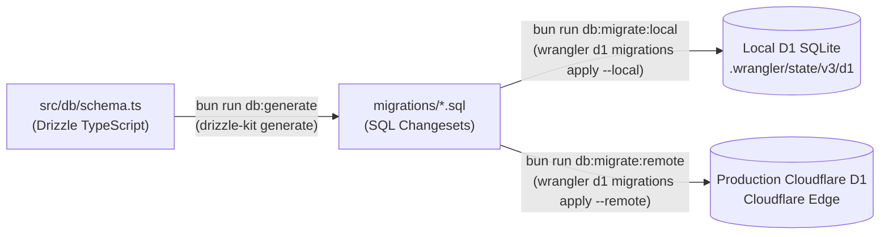

# Fitwear Backend Architecture & Coding Practices Guide

The Fitwear backend runs ElysiaJS on Cloudflare Workers, Drizzle on D1, private meal photos on R2, and meal-image inference on Workers AI. Bun is the local development/test runner, not the production runtime.

---

## 1. Feature-Based Modular Architecture

Code is organized into isolated, feature-driven business domains:

```text
apps/backend/
├── src/app.ts              # Elysia plugin composition and compiled app
├── src/index.ts            # Cloudflare Worker entrypoint and per-invocation bindings
├── src/db/                 # Schema and request-scoped binding access
├── src/lib/                # Web Crypto IDs, bcrypt, nutrition/date logic, private photos
├── src/modules/
│   ├── auth/               # Email/password accounts, sessions, profile updates and reset requests
│   ├── email/              # Typed Queue messages and Resend consumer
│   ├── user/               # Current profile
│   ├── foods/              # Searchable per-100g/ml food catalogue
│   ├── targets/            # Stored daily targets or profile-derived estimates
│   ├── meals/              # Logs/items, daily summaries, image inference/private photo reads
│   ├── health/             # Daily weight history and recovery schedules
│   ├── exercises/          # Catalogue, technique cues and repetition/time units
│   └── workouts/           # Sessions, sets, completion and training statistics
├── migrations/             # Additive SQL migrations and matching Drizzle snapshots
├── scripts/smoke.ts        # Actual Worker/D1/R2 lifecycle smoke; optional Workers AI call
├── tests/unit/             # Validation, nutrition, dates, credentials, binding isolation
└── tests/integration/      # Routes against migrated SQLite with foreign keys enabled
```

Each feature owns its Elysia `.model()` registry beside its routes. Route body/query schemas are referenced by name, and services import inferred types from their route module; there are no parallel `model.ts` schema files.

The mobile client uses these endpoints rather than seeded personal data. Every private data query is scoped to the authenticated user. Food/exercise catalogue entries are reference data, not generated workout or meal history.

---

## 2. Core Coding Practices & Standards

### A. Boyce-Codd Normal Form (3.5NF / BCNF)
The database schema strictly adheres to **BCNF (3.5NF)**:
1. **Every Determinant Is a Candidate Key**:
   - `user`: Superkeys are `id` and `email`.
   - `session`: Superkeys are `id` and `token`.
   - `dailyTargets`: Superkeys are `id` and `(userId, targetDate)`.
   - `exercises`: Superkeys are `id` and `name`.
   - `workoutSets`: Superkeys are `id` and `(workoutSessionId, setIndex)`.
2. **Zero Transitive or Derived Redundancy**:
   - `user`: Calculated metrics (`bmrKcal`, `tdeeKcal`) were removed because they depend functionally on `(heightCm, currentWeightKg, birthDate, gender, activityLevel)`.
   - `workoutSessions`: Aggregate sums like `totalVolumeKg` are omitted in favor of SQL aggregate queries over `workoutSets`.
   - `mealLogs`: Totals are computed on-demand from the atomic `mealItems` child records.
3. **Lean Authentication Schema**:
   - No redundant multi-provider `account` table. Password hashes reside directly on `user.password`.

### B. Atomic Database Transactions via Cloudflare D1 Batch API
Multi-table write operations must execute within an atomic transaction. On Cloudflare D1, transactions are executed via `db.batch`:
- **Atomic Execution**: All statements run in a single local SQLite transaction (`BEGIN TRANSACTION ... COMMIT`).
- **Automatic Rollback**: Any error rolls back all writes in the batch.
- **Single HTTP Roundtrip**: Sends queries as a single payload to Cloudflare D1.

Example in `Auth.signUp`:
```typescript
await db.batch([
  db.insert(userTable).values(newUser),
  db.insert(sessionTable).values(newSession),
]);
```

### C. Elimination of N+1 & Consecutive Queries
- **Sign-in**: A single query fetches the user and credentials.
- **Session Validation**: Joins `session` and `user` in a single query rather than making consecutive roundtrips:
  ```typescript
  const record = await db
    .select({ user: userTable, session: sessionTable })
    .from(sessionTable)
    .innerJoin(userTable, eq(sessionTable.userId, userTable.id))
    .where(eq(sessionTable.token, token))
    .get();
  ```

### D. Production Runtime Compatibility
- IDs use `crypto.randomUUID()`; session tokens use 32 cryptographically random bytes.
- `src/app.ts` composes feature plugins and compiles one Elysia app; `src/index.ts` is the Cloudflare module-worker entrypoint and types its `fetch` handler against generated `Env`.
- Passwords use `bcryptjs` cost 12. Existing bcrypt hashes remain verifiable and are upgraded to cost 12 after successful sign-in.
- New passwords require at least 8 characters for usability, accept all characters and spaces, and are limited to 72 UTF-8 bytes to prevent bcrypt's silent truncation.
- Sign-in is throttled by both client IP and a SHA-256-keyed account identifier. Wrong-password and unknown-account logins share one error response; password-reset requests are non-enumerating.
- The Cloudflare adapter's Elysia handler accepts `Request`; the Worker entrypoint scopes `env` with `AsyncLocalStorage.run()` so D1/KV/AI/R2, Queue and email config remain isolated across concurrent invocations, without mutable request-global variables.
- Wrangler enables Workers Logs (10% request sampling) and traces (1% sampling) to provide production diagnostics while limiting volume.
- Mobile requests use bearer tokens and omit cookies. Cross-origin credentialed cookies are disabled; same-origin auth cookies are Secure, HttpOnly and SameSite=Lax.

### E. Fast Prototyping & Zero Boilerplate
- **Inherited Controller Tags**: Setting `detail: { tags: ['Authentication'] }` on the controller instance tags all sub-routes automatically.
- **Automatic Type Inference**: Response models are optional. Elysia infers TypeScript return types automatically.
- **Declarative Auth with `{ auth: true }` Macro**:
  ```typescript
  .get('/session', ({ user, session }) => ({ user, session }), { auth: true })
  ```
  Automatically validates session from Bearer headers or cookies, injects `{ user, session, token }`, returns 401 on unauthenticated calls, and documents OpenAPI security schemes.

### F. Self-Documenting Code (Zero-Comment Policy)
- The codebase enforces clean, self-explanatory variable and function naming.
- Obvious, decorative, or section-header comments are prohibited in source files.

---

## 3. Test Suites (Unit, Integration & Native E2E)

### Commands

From repository root:
```bash
bun run test                     # Backend Bun tests + mobile Expo Jest tests
bun run backend:test:unit        # Run unit tests only
bun run backend:test:integration # Run integration tests only
bun run test:e2e                 # Run the single Maestro native mobile flow
```

From `apps/backend/`:
```bash
bun run test                     # Unit & integration tests (Bun test)
bun run test:unit                # Unit tests (tests/unit)
bun run test:integration         # Integration tests (tests/integration)
```

The only E2E test is the native Maestro flow in `apps/mobile/tests/e2e/fitness.yaml`. Mobile CI runs it nightly at 02:00 UTC and on manual workflow dispatch, using an Android emulator and local Wrangler backend with D1 migrations applied. The workflow provisions the backend, native build, emulator, and Maestro CLI.

For runtime proof, first apply local migrations and run Wrangler on port 8788, then run `bun scripts/smoke.ts` from `apps/backend`. Set `SMOKE_API_URL` to the deployed Worker to exercise production D1/R2. Set `SMOKE_ANALYZE=1` to include a real Workers AI call (billable provider usage). The smoke deletes its meals/workouts/recovery/targets and revokes both sessions; its uniquely named test accounts and weight logs remain for inspection.

---

## 4. Database Migrations Workflow

The backend uses **Drizzle Kit** as the schema migration generator and **Cloudflare Wrangler** as the migration executor on Cloudflare D1 (SQLite).

### Migration Architecture



1. **Schema Definition**: Database tables and constraints are defined in [`src/db/schema.ts`](file:///C:/Users/Toan/huawei-fitwear/apps/backend/src/db/schema.ts).
2. **Migration Generation (`bun run db:generate`)**:
   - `drizzle-kit generate` compares `src/db/schema.ts` against the previous schema snapshots stored in `migrations/meta/`.
   - Produces a sequential, idempotent SQL migration file (e.g. `migrations/0001_public_galactus.sql`).
3. **Local Migration Execution (`bun run db:migrate:local`)**:
   - Runs `wrangler d1 migrations apply fitwear-d1 --local`.
   - Executes pending SQL migrations against the local Miniflare SQLite database under `.wrangler/state/v3/d1`.
   - Tracks applied migrations in the internal `d1_migrations` table.
4. **Remote / Production Migration Execution (`bun run db:migrate:remote`)**:
   - Runs `wrangler d1 migrations apply fitwear-d1 --remote`.
   - Cloudflare D1 executes unapplied migrations within an atomic migration transaction on the production database.

### Step-by-Step Workflow for Schema Changes

1. **Edit Schema**: Modify or add tables/columns in [`src/db/schema.ts`](file:///C:/Users/Toan/huawei-fitwear/apps/backend/src/db/schema.ts) following 3.5NF guidelines.
2. **Generate Migration**:
   ```bash
   cd apps/backend
   bun run db:generate
   ```
   *Note: If a table has both added and removed columns, Drizzle Kit will ask whether a column was renamed or newly created.*
3. **Verify Generated SQL**: Check the generated `.sql` file in `apps/backend/migrations/` to ensure statements match expectations.
4. **Apply Locally**:
   ```bash
   bun run db:migrate:local
   ```
5. **Run Tests**:
   ```bash
   bun test
   bun run test:e2e
   ```
6. **Apply to Production (CI/CD / Release)**:
   ```bash
   bun run db:migrate:remote
   ```

### Release via GitHub Actions

`.github/workflows/release.yml` validates both applications before migrating D1 and deploying the backend.

- **Triggers**: Every push to `main`, or manual dispatch. Migration and deployment run only on `main`.
- **Release gates**:
  - `ci`: Backend typecheck → mobile typecheck → backend unit/integration tests → mobile Jest tests → Wrangler dry-run build, in sequence.
  - `checks`: Lint and formatting run in parallel. Release checks never autoformat or commit changes.
  - Maestro E2E remains nightly/manual in Mobile CI; it is not a release gate.
- **Deployment**: After all gates succeed, `deploy` applies remote D1 migrations, then runs `bun run backend:deploy` (`wrangler deploy`). A failed migration prevents deployment.
- **Rollback**: Worker rollback does not reverse D1 migrations; review schema changes for compatibility with the currently deployed Worker before merging.
- **Secrets Management**:
  Secrets are provisioned using Wrangler and GitHub CLI (`gh`):
  ```bash
  # 1. Retrieve the Cloudflare OAuth / API token from Wrangler
  TOKEN=$(bun -e "console.log(JSON.parse(require('child_process').execSync('wrangler auth token --json')).token)")

  # 2. Set repository secrets using GitHub CLI
  gh secret set CLOUDFLARE_API_TOKEN --body "$TOKEN"
  gh secret set CLOUDFLARE_ACCOUNT_ID --body "cf5f13bd5550ea98e75fea6f3ddd321b"
  ```

---

## 5. Development & Deployment

```bash
cd apps/backend
bun run dev             # Start local Cloudflare Workers dev server
bun run build           # Dry-run build verification (wrangler deploy --dry-run)
bun run deploy          # Deploy to Cloudflare Workers
bun run db:generate     # Generate new Drizzle SQL migration from schema.ts
bun run db:migrate:local  # Apply D1 migrations locally (.wrangler/state/v3/d1)
bun run db:migrate:remote # Apply D1 migrations to remote Cloudflare production D1
bun run typecheck       # TypeScript verification (tsc --noEmit)
```

Production API: https://fitwear-backend.dangduytoan13l.workers.dev

Bindings in `wrangler.json`: `DB` (D1), `fitwear_kv` (rate limits), `MEAL_IMAGES` (private R2 bucket `fitwear-meal-images`), `AI` (Workers AI), and `EMAIL_QUEUE` (`fitwear-email`). The image-analysis route uses `@cf/google/gemma-4-26b-a4b-it`; input and output are bounded and validated. Estimates are reviewed/edited before logging, never treated as measurements.

Migrations `0002_feature_persistence.sql` and `0003_meal_item_units.sql` add weights, recovery, food reference data, exercise guidance, weekly session preferences and g/ml persistence. They preserve existing users, credentials, sessions and logs. For application rollback, deploy the preceding Worker version and retain additive columns/tables; do not drop live data. Take a D1 export or Time Travel bookmark before remote migrations.

Password reset follows `POST /auth/password-reset` → `POST /auth/password-reset/verify` → `POST /auth/reset-password`. Reset codes are cryptographically generated four-digit OTPs, stored only as SHA-256 digests, and expire after 10 minutes. Issuing a new code atomically replaces prior OTP and reset-token records using the D1 batch API. Successful verification atomically consumes the OTP and exchanges it for a cryptographically random reset token stored only as a SHA-256 digest for 10 minutes. The final endpoint accepts only `{ resetToken, password }`; reset tokens are one-use, and completing a reset revokes all sessions. OTP verification and reset-token confirmation are rate-limited, requests return identical success copy for registered and unknown addresses. Resend cooldown state is stored in KV, keyed by a hash of the normalized email, with 1, 2, 4, 8… minute delays capped at one hour. KV has no conditional compare-and-set: concurrent or cross-location requests may race and send duplicates; use D1 or Durable Objects if strict single-send enforcement becomes necessary. Suppressed requests still receive the same generic response.
The generic request response includes `resendAfterSeconds`, which is safe for known and unknown addresses. The mobile OTP screen displays that server-provided cooldown and updates it while the app is backgrounded.

Both email types are delivered through the `fitwear-email` Queue and retried up to five times before reaching `fitwear-email-dlq`. The single push consumer is configured with `max_concurrency = 1` and spaces Resend request starts by at least 110 ms. Failed reset enqueue removes the newly created OTP record; failed welcome enqueue does not fail signup. Queue message bodies are not logged. Resend idempotency keys use Cloudflare message IDs and only deduplicate within Resend's 24-hour idempotency window.

Set `RESEND_API_KEY` with `bunx wrangler secret put RESEND_API_KEY` and `RESEND_FROM` to a sender verified in Resend. `RESEND_WELCOME_TEMPLATE_ID` and `RESEND_PASSWORD_RESET_TEMPLATE_ID` are public Worker variables in `wrangler.json`. The Resend templates are `fitwear-welcome` and `voochealth-password-reset`; the welcome template accepts `NAME`, and the reset template accepts only `RESET_OTP`. Provision the queues once with `bunx wrangler queues create fitwear-email` and `bunx wrangler queues create fitwear-email-dlq`; the Worker consumer configuration is in Wrangler JSON. Never store the API key in `wrangler.json`, app code, or an `EXPO_PUBLIC_*` variable.

The source HTML is in `apps/backend/email-templates/`. `.github/workflows/resend-templates.yml` runs after template changes land on `main` and can also be started manually from GitHub Actions. Configure the repository Actions secret `RESEND_API_KEY` with a Resend API key that can edit templates. The workflow validates the files, PATCHes HTML to the existing template IDs from `apps/backend/wrangler.json`, then publishes each successful update so future sends use it. It does not create or replace templates, or modify sender or subject. Run `bun apps/backend/scripts/sync-resend-templates.ts --dry-run` locally to validate the template markup and variable names without contacting Resend. Changes deploy to Resend only after they reach `main` or the workflow is manually dispatched.

