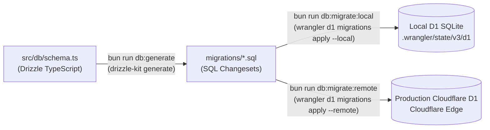

# Fitwear Backend Architecture & Coding Practices Guide

The Fitwear backend is built on **ElysiaJS** running on Cloudflare Workers and D1 Database via Drizzle ORM, powered by Bun runtime native APIs.

---

## 1. Feature-Based Modular Architecture

Code is organized into isolated, feature-driven business domains:

```
apps/backend/
├── src/
│   ├── db/                     # D1 Database connection & Drizzle schemas
│   │   ├── index.ts            # D1 Drizzle instance helper & binding receiver
│   │   └── schema.ts           # 3.5NF / BCNF relational schemas (SQLite / D1)
│   ├── lib/
│   │   ├── id.ts               # Bun native UUIDv7 and token generator
│   │   └── password.ts         # Bun native C++ bcrypt password hashing
│   ├── modules/
│   │   ├── auth/               # Authentication domain module
│   │   │   ├── model.ts        # Validation schemas with Elysia's type system (t)
│   │   │   ├── service.ts      # Decoupled business logic (Auth class) + authGuard macro
│   │   │   └── index.ts        # Elysia controller router
│   │   └── user/               # User domain module
│   │       ├── service.ts      # Decoupled user query operations (User class)
│   │       └── index.ts        # Elysia controller router
│   └── index.ts                # Application root: CORS, Swagger UI (/swagger), module mounting
├── tests/
│   ├── helpers/
│   │   ├── test-db.ts          # In-memory SQLite D1 simulator with atomic batch transaction support
│   │   └── test-server.ts      # Standalone test server runner for Playwright
│   ├── unit/                   # Unit tests (Bun test)
│   │   ├── model.unit.test.ts  # Input validation schemas (TypeBox Value.Check)
│   │   └── password.unit.test.ts # Bun native bcrypt hashing & salt verification
│   ├── integration/            # Integration tests (Bun test)
│   │   ├── api.integration.test.ts  # Root & Swagger OpenAPI schema tests
│   │   ├── auth.integration.test.ts # Sign-up, duplicate checks, login, session, biometrics, sign-out
│   │   └── user.integration.test.ts # Protected user profile tests
│   └── e2e/                    # End-to-End tests (Playwright)
│       ├── api.e2e.ts          # Complete user lifecycle over HTTP network requests
│       └── swagger.e2e.ts      # Headless Chromium UI testing of Swagger documentation
└── playwright.config.ts        # Playwright test configuration with automated webServer
```

---

## 2. Core Coding Practices & Standards

### A. Boyce-Codd Normal Form (3.5NF / BCNF)
The database schema strictly adheres to **BCNF (3.5NF)**:
1. **Every Determinant Is a Candidate Key**:
   - `user`: Superkeys are `id` and `email`.
   - `session`: Superkeys are `id` and `token`.
   - `dailyTargets`: Superkeys are `id` and `(userId, targetDate)`.
   - `exercises`: Superkeys are `id` and `name`.
   - `workoutSets`: Superkeys are `id` and `(workoutSessionId, setIndex)`.
2. **Zero Transitive or Derived Redundancy**:
   - `user`: Calculated metrics (`bmrKcal`, `tdeeKcal`) were removed because they depend functionally on `(heightCm, currentWeightKg, birthDate, gender, activityLevel)`.
   - `workoutSessions`: Aggregate sums like `totalVolumeKg` are omitted in favor of SQL aggregate queries over `workoutSets`.
   - `mealLogs`: Totals are computed on-demand from the atomic `mealItems` child records.
3. **Lean Authentication Schema**:
   - No redundant multi-provider `account` table. Password hashes reside directly on `user.password`.

### B. Atomic Database Transactions via Cloudflare D1 Batch API
Multi-table write operations must execute within an atomic transaction. On Cloudflare D1, transactions are executed via `db.batch`:
- **Atomic Execution**: All statements run in a single local SQLite transaction (`BEGIN TRANSACTION ... COMMIT`).
- **Automatic Rollback**: Any error rolls back all writes in the batch.
- **Single HTTP Roundtrip**: Sends queries as a single payload to Cloudflare D1.

Example in `Auth.signUp`:
```typescript
await db.batch([
  db.insert(userTable).values(newUser),
  db.insert(sessionTable).values(newSession),
]);
```

### C. Elimination of N+1 & Consecutive Queries
- **Sign-in**: A single query fetches the user and credentials.
- **Session Validation**: Joins `session` and `user` in a single query rather than making consecutive roundtrips:
  ```typescript
  const record = await db
    .select({ user: userTable, session: sessionTable })
    .from(sessionTable)
    .innerJoin(userTable, eq(sessionTable.userId, userTable.id))
    .where(eq(sessionTable.token, token))
    .get();
  ```

### D. Always Use Bun Native APIs
- **UUIDv7**: Primary keys and IDs are generated using `Bun.randomUUIDv7()` (via `src/lib/id.ts`) for high-performance, time-ordered B-tree indexing without external prefixes.
- **Password Hashing**: `Bun.password.hash(password, { algorithm: 'bcrypt', cost: 10 })` and `Bun.password.verify(...)` avoid third-party crypto bloat.
- **Environment**: Use `Bun.env` instead of `process.env`.

### E. Fast Prototyping & Zero Boilerplate
- **Inherited Controller Tags**: Setting `detail: { tags: ['Authentication'] }` on the controller instance tags all sub-routes automatically.
- **Automatic Type Inference**: Response models are optional. Elysia infers TypeScript return types automatically.
- **Declarative Auth with `{ auth: true }` Macro**:
  ```typescript
  .get('/session', ({ user, session }) => ({ user, session }), { auth: true })
  ```
  Automatically validates session from Bearer headers or cookies, injects `{ user, session, token }`, returns 401 on unauthenticated calls, and documents OpenAPI security schemes.

### F. Self-Documenting Code (Zero-Comment Policy)
- The codebase enforces clean, self-explanatory variable and function naming.
- Obvious, decorative, or section-header comments are prohibited in source files.

---

## 3. Test Suites (Unit, Integration & E2E)

### Commands

From repository root:
```bash
bun test                          # Run all unit & integration tests
bun run backend:test:unit         # Run unit tests only
bun run backend:test:integration  # Run integration tests only
bun run test:e2e                  # Run Playwright E2E tests
```

From `apps/backend/`:
```bash
bun test                          # Unit & integration tests (Bun test)
bun run test:unit                 # Unit tests (tests/unit)
bun run test:integration          # Integration tests (tests/integration)
bun run test:e2e                  # Playwright E2E tests (tests/e2e)
```

---

## 4. Database Migrations Workflow

The backend uses **Drizzle Kit** as the schema migration generator and **Cloudflare Wrangler** as the migration executor on Cloudflare D1 (SQLite).

### Migration Architecture



1. **Schema Definition**: Database tables and constraints are defined in [`src/db/schema.ts`](file:///C:/Users/Toan/huawei-fitwear/apps/backend/src/db/schema.ts).
2. **Migration Generation (`bun run db:generate`)**:
   - `drizzle-kit generate` compares `src/db/schema.ts` against the previous schema snapshots stored in `migrations/meta/`.
   - Produces a sequential, idempotent SQL migration file (e.g. `migrations/0001_public_galactus.sql`).
3. **Local Migration Execution (`bun run db:migrate:local`)**:
   - Runs `wrangler d1 migrations apply fitwear-d1 --local`.
   - Executes pending SQL migrations against the local Miniflare SQLite database under `.wrangler/state/v3/d1`.
   - Tracks applied migrations in the internal `d1_migrations` table.
4. **Remote / Production Migration Execution (`bun run db:migrate:remote`)**:
   - Runs `wrangler d1 migrations apply fitwear-d1 --remote`.
   - Cloudflare D1 executes unapplied migrations within an atomic migration transaction on the production database.

### Step-by-Step Workflow for Schema Changes

1. **Edit Schema**: Modify or add tables/columns in [`src/db/schema.ts`](file:///C:/Users/Toan/huawei-fitwear/apps/backend/src/db/schema.ts) following 3.5NF guidelines.
2. **Generate Migration**:
   ```bash
   cd apps/backend
   bun run db:generate
   ```
   *Note: If a table has both added and removed columns, Drizzle Kit will ask whether a column was renamed or newly created.*
3. **Verify Generated SQL**: Check the generated `.sql` file in `apps/backend/migrations/` to ensure statements match expectations.
4. **Apply Locally**:
   ```bash
   bun run db:migrate:local
   ```
5. **Run Tests**:
   ```bash
   bun test
   bun run test:e2e
   ```
6. **Apply to Production (CI/CD / Release)**:
   ```bash
   bun run db:migrate:remote
   ```

### Remote Migrations via GitHub Actions (CI/CD)

The remote Cloudflare D1 database is automatically migrated via [`.github/workflows/d1-migrate.yml`](file:///C:/Users/Toan/huawei-fitwear/.github/workflows/d1-migrate.yml).

- **Triggers**:
  - `push` to `main` when `apps/backend/migrations/**`, `apps/backend/src/db/**`, or the workflow file changes.
  - `workflow_dispatch` for on-demand manual triggers from GitHub Actions UI or `gh workflow run`.
- **Pipeline Stages**:
  1. Installs Bun and dependencies.
  2. Runs static type checking (`bun run backend:typecheck`).
  3. Executes unit and integration test suites (`bun run backend:test`).
  4. Applies pending migrations remotely via `bun run db:migrate:remote`.
- **Secrets Management**:
  Secrets are provisioned using Wrangler and GitHub CLI (`gh`):
  ```bash
  # 1. Retrieve the Cloudflare OAuth / API token from Wrangler
  TOKEN=$(bun -e "console.log(JSON.parse(require('child_process').execSync('wrangler auth token --json')).token)")

  # 2. Set repository secrets using GitHub CLI
  gh secret set CLOUDFLARE_API_TOKEN --body "$TOKEN"
  gh secret set CLOUDFLARE_ACCOUNT_ID --body "cf5f13bd5550ea98e75fea6f3ddd321b"
  ```

---

## 5. Development & Deployment

```bash
cd apps/backend
bun run dev             # Start local Cloudflare Workers dev server
bun run build           # Dry-run build verification (wrangler deploy --dry-run)
bun run deploy          # Deploy to Cloudflare Workers
bun run db:generate     # Generate new Drizzle SQL migration from schema.ts
bun run db:migrate:local  # Apply D1 migrations locally (.wrangler/state/v3/d1)
bun run db:migrate:remote # Apply D1 migrations to remote Cloudflare production D1
bun run typecheck       # TypeScript verification (tsc --noEmit)
```
