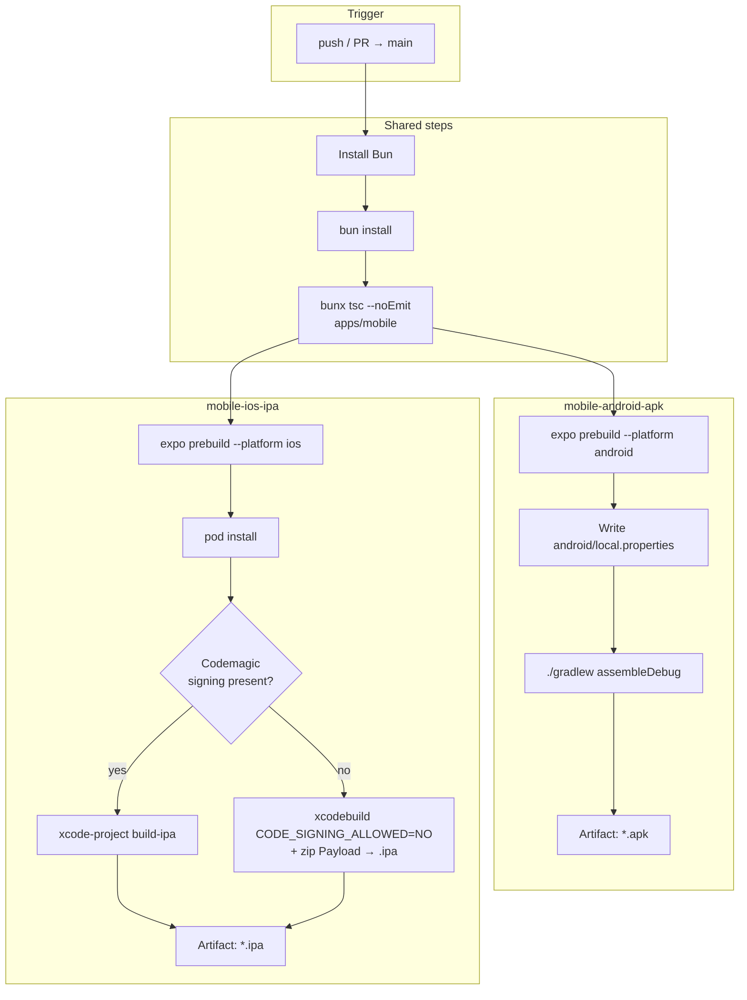

# Codemagic mobile build pipeline

Builds `apps/mobile` (Expo SDK 57 + `react-native-ble-plx`) into installable **APK** and **IPA**. Native modules require `expo prebuild` — Expo Go is not used in CI.

Config file: [`codemagic.yaml`](../../codemagic.yaml) at the repo root.

## Workflows

| Workflow ID | Product | Trigger |
|-------------|---------|---------|
| `mobile-android-apk` | Debug APK | push / PR to `main` |
| `mobile-ios-ipa` | Development IPA (or unsigned `.ipa` if signing missing) | push / PR to `main` |

## Pipeline diagram



## Why this shape

1. **Bun** matches the monorepo package manager.
2. **Typecheck** fails the build before native compile.
3. **`expo prebuild`** generates `android/` / `ios/` with the ble-plx Expo config plugin (permissions + native code).
4. **Android** ships a **debug APK** by default (no keystore required). Upload a keystore in Codemagic to add a release workflow later.
5. **iOS** uses Codemagic code signing when certificates are configured; otherwise CI still verifies an unsigned compile packaged as `.ipa`.

## Codemagic setup checklist

1. Connect the GitHub repo `caphefalumi/huawei-fitwear`.
2. Ensure `codemagic.yaml` is detected at the repository root.
3. **iOS**: Team → Code signing → add Apple cert + profile for `com.fitwear.mobile`.
4. **Android release** (optional): add keystore env vars, then switch Gradle to `assembleRelease` / `bundleRelease`.
5. Run `Mobile Android APK` and `Mobile iOS IPA` on `main`.

## Local equivalents

```bash
# Android APK
cd apps/mobile
bunx expo prebuild --platform android --clean
cd android && ./gradlew assembleDebug

# iOS (macOS)
cd apps/mobile
bunx expo prebuild --platform ios --clean
cd ios && pod install
xcodebuild -workspace mobile.xcworkspace -scheme mobile -configuration Debug
```

## EAS alternative

[`apps/mobile/eas.json`](../../apps/mobile/eas.json) remains available for Expo Application Services builds. Codemagic is the primary CI path defined in this repo.
